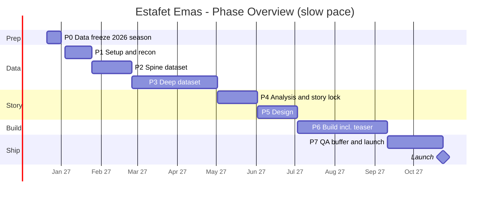
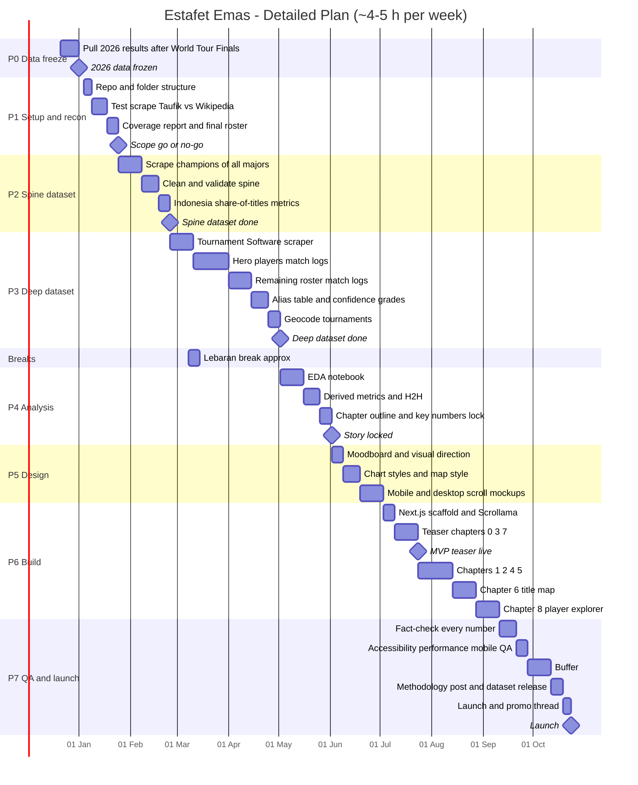

# Estafet Emas: Timeline & Project Management
### Slow-pace plan for the Indonesian badminton legends scrollytelling project

**Companion to:** `indonesia-badminton-legends-spec.md`
**Version:** v0.1 (24 Nov 2026)
**Pace:** Slow and steady, about **4–5 hours/week**, running in the background while other projects finish first

---

## 1. Planning assumptions

| Item | Assumption |
|------|------------|
| Weekly capacity | ~4–5 h/week (e.g., one 2–3 h weekend block plus one 1–2 h weekday evening) |
| Total effort | ~185 hours (same scope as the spec, spread thinly) |
| Main start | **Mon 4 Jan 2027**, after current projects wrap up |
| Pre-start task | One small **data-freeze session** in late Dec 2026, right after the BWF World Tour Finals, so the 2026 season is captured while it's fresh |
| Target launch | **~23 Oct 2027** (about 10 months, including a 2-week buffer) |
| MVP teaser | **~23 Jul 2027** (Chapters 0, 3 and 7 live), something to show recruiters mid-way |
| Breaks | Lebaran 2027 (approx. early–mid March) is absorbed into the deep-dataset phase, which has slack built in |
| Story cut-off | The story ends at the **2026 season**. 2027 results are *not* chased during the build; at most, they become a short epilogue during QA |

> **Shifting the plan:** Every task in the detailed Gantt (§3) is chained with `after`, so if other projects run late you only change **one date** (`p1a`), and everything else moves with it.

---

## 2. Phase overview (summary Gantt)

| Phase | Dates (approx.) | Effort | Output |
|-------|-----------------|--------|--------|
| P0 Data freeze | 21–31 Dec 2026 | 6 h | 2026 season results saved raw, before sites change |
| P1 Setup & recon | 4–24 Jan 2027 | 12 h | Repo, Taufik test scrape, coverage report, final roster |
| P2 Spine dataset | 25 Jan – 24 Feb | 20 h | Champions of all majors, all countries, 1949–2026 |
| P3 Deep dataset | 25 Feb – 1 May | 45 h | Match logs for the roster, alias table, geocoded tournaments |
| P4 Analysis & story lock | 2 May – 1 Jun | 20 h | EDA notebook, metrics, locked chapter outline |
| P5 Design | 2 Jun – 2 Jul | 18 h | Visual direction, chart and map styles, scroll mockups |
| P6 Build | 3 Jul – 10 Sep | 50 h | Next.js site; **teaser live ~23 Jul** |
| P7 QA, buffer, launch | 11 Sep – 23 Oct | 14 h + buffer | Fact-check, a11y, methodology post, launch |

---

## 3. Detailed Gantt (task level)

> Renders in GitHub, GitLab, Obsidian, Notion (code block → Mermaid) and VS Code with a Mermaid preview extension. To edit it visually, paste it into https://mermaid.live.

---

## 4. Task backlog

Status keys: ⬜ Not started · 🟨 In progress · ✅ Done · ⏸ Paused

| ID | Task | Est. (h) | Depends on | Definition of done | Status |
|----|------|---------:|-----------|--------------------|:------:|
| **s1** | Pull 2026 season results (World Tour Finals, World Champs, Thomas/Uber, Asian Games, key World Tour events) | 6 | — | Raw HTML/CSV saved to `/data/raw/2026/`, with source URLs logged | ⬜ |
| **p1a** | Repo and folder structure (`/data`, `/pipeline`, `/web`, `/docs`) | 2 | — | Repo on GitHub, README with project pitch | ⬜ |
| **p1b** | Test scrape of Taufik Hidayat on Tournament Software vs. Wikipedia | 6 | p1a | Notebook comparing the two; list of missing events | ⬜ |
| **p1c** | Coverage report and final roster | 4 | p1b | Coverage % per player/era; roster locked; hero list (6) locked | ⬜ |
| **p2a** | Scrape champions lists: Olympics, WC, All England, Thomas/Uber/Sudirman, Asian Games, Finals | 8 | p1c | One raw table per event | ⬜ |
| **p2b** | Clean and validate the spine | 7 | p2a | Tidy `titles_spine` table; spot-checked against BWF history | ⬜ |
| **p2c** | Indonesia share-of-titles metrics | 5 | p2b | Per-year/decade share table and first static "baton line" chart | ⬜ |
| **p3a** | Tournament Software scraper (cached, rate-limited) | 8 | p2c | Scraper fetches any player's match list into a `matches` table | ⬜ |
| **p3b** | Match logs for hero players (Susi, Alan, Taufik, Tontowi/Liliyana, Kevin/Marcus, current hero) | 15 | p3a | Hero match logs with confidence grades; gaps filled from Wikipedia/Olympedia | ⬜ |
| **p3c** | Match logs for the remaining roster | 10 | p3b | All roster players present (titles-only for Pioneers) | ⬜ |
| **p3d** | Alias table and confidence grades | 7 | p3c | No duplicate players; every row graded A/B/C | ⬜ |
| **p3e** | Geocode tournaments | 5 | p3d | `tournaments` GeoJSON with city lat/lon | ⬜ |
| **p4a** | EDA notebook | 9 | p3e | Win rates, peaks, H2H explored; interesting findings noted | ⬜ |
| **p4b** | Derived metrics and H2H tables | 6 | p4a | Chapter-ready JSON/Parquet per chapter | ⬜ |
| **p4c** | Chapter outline and key numbers lock | 5 | p4b | Each chapter: headline number, chart, 3–5 scroll steps, sources | ⬜ |
| **p5a** | Moodboard and visual direction | 4 | p4c | Palette (red/white + gold baton), type, references | ⬜ |
| **p5b** | Chart styles and map style | 6 | p5a | Figma components for grid, baton line, H2H, map | ⬜ |
| **p5c** | Mobile and desktop scroll mockups | 8 | p5b | Figma frames for all 9 chapters (0–8) | ⬜ |
| **p6a** | Next.js scaffold and Scrollama | 4 | p5c | Step-scroll skeleton deployed to Vercel preview | ⬜ |
| **p6b** | Teaser: Chapters 0, 3, 7 | 12 | p6a | **MVP live**; shared on LinkedIn/portfolio | ⬜ |
| **p6c** | Chapters 1, 2, 4, 5 | 16 | p6b | All four chapters scroll and read correctly on mobile | ⬜ |
| **p6d** | Chapter 6: title map (MapLibre) | 9 | p6c | Animated decade map; Istora highlight | ⬜ |
| **p6e** | Chapter 8: player explorer | 9 | p6d | Search, filters and a mini match grid for any roster player | ⬜ |
| **p7a** | Fact-check every number | 5 | p6e | Every on-page number traced to a source row | ⬜ |
| **p7b** | Accessibility, performance and mobile QA | 4 | p7a | Lighthouse ≥ 90; alt text and keyboard nav; tested on 3 phones | ⬜ |
| **buf** | Buffer (catch-up / optional 2027 epilogue) | — | p7b | Used only if needed | ⬜ |
| **p7c** | Methodology post and dataset release | 3 | buf | Methodology page; dataset on GitHub/Kaggle (terms checked) | ⬜ |
| **p7d** | Launch and promo thread | 2 | p7c | Site live; LinkedIn/Threads thread; portfolio case study | ⬜ |
| | **Total** | **~185** | | | |

---

## 5. Milestones

| ID | Milestone | Target | Why it matters |
|----|-----------|--------|----------------|
| m0 | 2026 data frozen | 31 Dec 2026 | Captures the 2026 crossroads season before it fades from the news |
| m1 | Scope go / no-go | 24 Jan 2027 | Confirms data coverage is good enough; trims the roster if not |
| m2 | Spine dataset done | 24 Feb 2027 | The baton line is possible from here; first shareable chart |
| m3 | Deep dataset done | 1 May 2027 | Biggest risk is behind you |
| m4 | Story locked | 1 Jun 2027 | No new chapters after this point (scope freeze) |
| m5 | **MVP teaser live** | **23 Jul 2027** | Portfolio piece for recruiters, half-way through |
| m6 | **Launch** | **23 Oct 2027** | Full story published |

---

## 6. Working rhythm

**Weekly cadence (~4–5 h)**
- **Weekend block (2–3 h):** deep work on the current task (scraping, building, designing)
- **Weekday evening (1–2 h):** small tasks: cleaning, notes, fact lookups
- **Sunday 10-minute check-in:** update the status column in §4 and write one line in the log (§8)

**Rules for a slow-pace project**
1. **One active task at a time.** Don't open a new task until the current one meets its Definition of Done.
2. **End every session with a "next step" note** in the log, so the next session starts in 2 minutes, not 20.
3. **Small public checkpoints.** Share one chart per phase (m2, m3, m5) on LinkedIn/Threads. This keeps momentum and builds an audience before launch.
4. **Pausing is allowed.** If other work spikes, mark the task ⏸ and change the start date of the next task in the Gantt. Everything after it shifts automatically.
5. **Scope freeze after m4.** New ideas go to a "v1.1 ideas" list, not into the build.

---

## 7. Risk watchlist (schedule view)

| Risk | Early signal | Response |
|------|--------------|----------|
| Other projects take longer than expected | P1 can't start by mid-Jan 2027 | Move `p1a` later; the whole chain shifts. Keep the s1 freeze regardless |
| Tournament Software scraping is blocked | p1b fails or gets rate-limited | Switch to Playwright; enter hero players manually; drop non-hero players to titles-only |
| P3 overruns (most likely) | p3b not done by mid-April | Cut the roster to heroes + finals only; use the buffer |
| Design perfectionism | P5 runs past July | Ship the teaser with v1 styles; polish during P6 |
| Motivation dip at the slow pace | 2+ weeks without a log entry | Publish a small chart from existing data to restart momentum |

---

## 8. Progress log (template)

| Week of | Hours | Task | Done this week | Next step | Blockers |
|---------|------:|------|----------------|-----------|----------|
| 21 Dec 2026 | | s1 | | | |
| 4 Jan 2027 | | p1a | | | |
| | | | | | |

---

## 9. Optional faster tracks

If the other projects finish early, the same plan compresses cleanly:

| Pace | Hours/week | Launch (approx.) |
|------|-----------:|------------------|
| Slow (this plan) | 4–5 | Oct 2027 |
| Medium | 7–8 | Jun–Jul 2027 |
| Original spec pace | 10–12 | Apr 2027 |

To switch pace, scale the day durations in §3 (e.g., halve them for medium pace) and keep the dependencies as they are.
